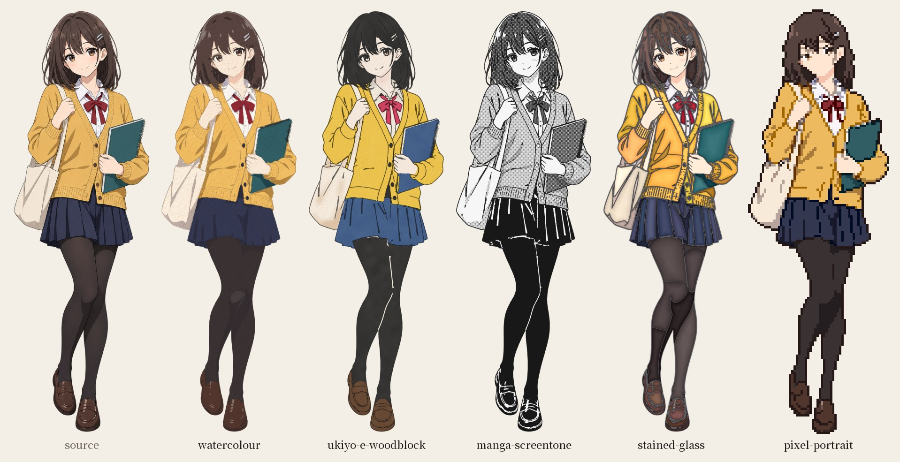
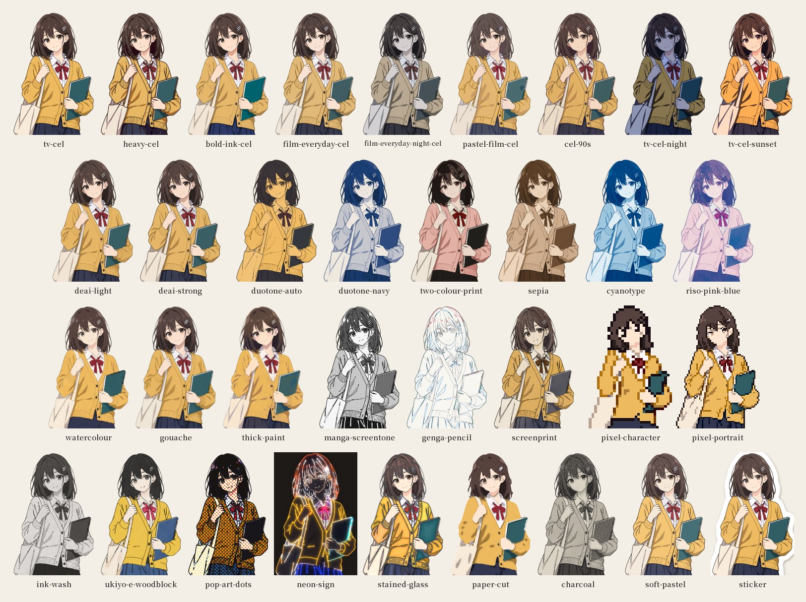

<p align="center">
  <picture>
    <source media="(prefers-color-scheme: dark)" srcset="assets/brand/logo-dark-1200.png">
    
  </picture>
</p>

<p align="center">
  <a href="README.md">English</a> ·
  <a href="README.zh-TW.md">繁體中文</a> ·
  <a href="README.zh-CN.md">简体中文</a> ·
  <strong>日本語</strong> ·
  <a href="README.ko.md">한국어</a>
</p>

<p align="center">
  <a href="https://github.com/owoevan-dev/refinish-skill/actions/workflows/tests.yml"></a>
  <a href="LICENSE"></a>
  
</p>

<p align="center"><strong>作り直さず、仕上げ直す。</strong></p>

Refinish は、手元にあるイラストを仕上げ直すための [Agent Skill](https://agentskills.io) です。線画、ポーズ、顔、衣装といった絵そのものはそのままに、影の形、線の色、配色、画材といった仕上げだけを描き替えます。テレビアニメのセル塗りや水彩から、浮世絵の木版、漫画のスクリーントーン、ドット絵まで、37 種類の仕上げを収録しています。生成画像によくある AI っぽさを抑えるのにも使えます。

処理はすべて Python（NumPy と OpenCV）で行い、画像生成モデルは使いません。入れたキャラクターが、そのまま出てきます。

<p align="center">
  
</p>

## 生成し直せばいいのでは？

画像生成モデルに別の画風で描き直させると、少し違うキャラクターになります。顔が変わり、手は描き直され、衣装の細部もずれていきます。一枚絵ならそれでも構わないかもしれません。けれど、揃っていなければならない立ち絵一式ではそうはいきません。

仕上げ直しは逆の考え方です。絵は固定したまま、仕上げだけを動かします。キャラクター全員で一つのルックを共有でき、制作の終盤でルックを変えても、描き直しは一枚も要りません。

## AI っぽさを抑える

生成画像には、ひと目でそれとわかる AI っぽさがあります。どこも同じ細かさ、エアブラシのようなグラデーション、余計なツヤやノイズ。仕上げ直しは、それをひとつの一貫した、意図のある手仕事の技法に置き換えます。セルの平塗り、水彩のにじみ、版画の線。元の見た目はそのままに痕跡だけを消したいなら、脱 AI 感の仕上げ（弱・強）を使います。

仕上げが変えるのは塗りで、絵そのものではありません。構図やディテールの密度、光から来る AI っぽさは、生成の段階で避ける必要があります（[source-spec.md](skills/refinish/references/source-spec.md)）。画像の出どころも隠しません。生成画像は仕上げたあとも生成画像であり、プラットフォームが開示を求めるものは、変わらず開示が必要です。

## 変わるもの、変わらないもの

| | |
|---|---|
| **変わる** | 線の太さ・色・質感、影の形と段数、ハイライト、配色と光（夜や夕方も含む）、画材（絵の具、紙、墨、スクリーントーン、ドット） |
| **変わらない** | プロポーション、目の描き方、ポーズ、しわ、構図 |

二行目は意図したものです。別の絵描きの顔の描き方でキャラクターを描かせたいなら、このツールは向いていません。自分の絵を、アニメの仕上げ部門や版画工房、ドット絵師のやり方で仕上げたいなら、このツールの出番です。

## 仕上げの種類

<p align="center">
  
</p>

| 系統 | 仕上げ |
|---|---|
| アニメのセル | テレビアニメ、濃いめのセル、太い主線、劇場版・日常、劇場版・夜、パステル調の劇場版、90 年代、テレビ・夜、テレビ・夕方 |
| クリーンな仕上げ | 脱 AI 感（弱・強）：元の絵の色と線はそのままに、レンダリングのノイズとエアブラシのグラデーションを取り除く |
| 二色・少色刷り | 元の絵の二色、紺の二色刷り、二色刷り、セピア、サイアノタイプ、リソグラフ |
| 絵画 | 水彩、ガッシュ、厚塗り |
| 版画と線画 | 漫画のスクリーントーン、アニメの原画、シルクスクリーン |
| 特殊技法 | 水墨、浮世絵木版、ベンデイドットのポップアート、ネオンサイン、ステンドグラス、切り絵、木炭、ソフトパステル、ステッカー |
| ドット絵 | 96 px のキャラクター、192 px のバストアップ |
| 風景 | 木版、水墨、水彩の風景 |

[presets.md](skills/refinish/references/presets.md) に、仕上げごとに必要なもの、元の絵の用意の仕方、苦手なことをまとめています。

## 背景とシーン

背景は扱いが違います。描かれた背景は線が少なく、空、もや、暗く沈んでいく室内といった長いグラデーションがほとんどです。セルの平塗りは、そのグラデーションを色の塊に割ってしまいます。そもそもアニメでも背景はセルで塗りません。セルはキャラクターで、それを描かれた背景の上に重ねます。

そこで背景にはクリーンな脱 AI 感の仕上げか風景用の仕上げを使い、その上にセル仕上げのキャラクターを重ねます。`composite.py` が被写界深度、ライトラップ、両者を同じ光にそろえるグレーディングを加えて合成します。

シーンの中に描かれたキャラクターは、先に `cutout.py` で切り抜けます。大まかな輪郭を描けば、正確な境界は色が決めます。キャラクターのいた場所を埋めた背景も一緒に得られるので、背景だけを別に仕上げられます。

## フィルターとの違い

- **ピクセルではなくパーツ単位。** サブジェクトファイルに、絵のどこが何か（肌、髪、それぞれの服）を書きます。素材ごとにその素材の色で塗るので、赤いリボンの色が隣の肌ににじむことはありません。ファイルは自動で下書きされ、数点のヒントで直します。
- **結果は毎回チェック。** 仕上げのたびに元の絵と比べ、パーツ、色、輪郭、失われた目鼻、別の色で刷られた肌、顔のまわりの四角、暗い布のまだらを確かめます。警告にはすべて、場所と考えられる原因が付きます。
- **参考画像に合わせる。** `fit_style.py` が参考画像の仕上げ（線の濃さ、彩度、平坦さ、エッジの柔らかさ、粒子感）を計測し、それに合うスタイルを何回かに分けて調整します。参考画像は計測するだけで、コピーはしません。
- **言葉で調整。** `tweak_style.py` は「影をやわらかく」「もっと鮮やかに」「線を太く」「陰影柔一點」といった言葉をパラメータの変更に置き換え、どの計測値が動くはずかも教えてくれます。
- **時間帯を変える。** 夜と夕方は、昼の色からリニアな光で求めるか、映画的な夜のグレーディングを使います。
- **仕上げを混ぜる。** `recipe.py` はパーツごとに仕上げを重ねます。服は水彩で顔はセル、あるいは水彩の上にスクリーントーンを乗算で重ねる、といった具合です。
- **元の絵を直す。** `repair.py` は、切り抜きのフチ、細かなゴミ、線画の途切れ、素材の境界を越えてにじんだ色を、画風を変えずに直します。

## どこまでできるか

以下の数字は、このプロジェクトが自前で、コードがまだ見たことのない画像を使って測ったものです（画像はリポジトリに含めていません）。画像を開く前にコードを凍結して合格基準を書き出し、一度見た画像は開発用にしか使いません。

- **パーツ。** 新しいキャラクター 2 セットで、エージェントのヒント付きの下書きは、41 枚中 39 枚が 2 回以内ですべてのパーツが正しくなりました。
- **37 種類の仕上げを新しいキャラクター 16 人に**（肌の色が濃い 10 人と、柔らかなエアブラシ塗りの 4 人を含む）。すべての計測に合格したのは 21 種類です。
  - 夕方と 90 年代を除くすべてのセル仕上げ
  - 脱 AI 感の 2 種類
  - 絵画系の仕上げ
  - ステンドグラス、切り絵、ステッカー

  暗い布にまだらを残した仕上げはありませんでした。
- **まだ足りないところ。** 以下は未解決の問題で、[変更履歴](CHANGELOG.md)に載せています。
  - 漫画のスクリーントーンは、濃い肌を薄く刷ってしまう
  - ポップアートは、顔のまわりに四角が残る
  - 浮世絵の木版は、日焼けした肌を明るくしすぎる
  - 柔らかなエアブラシ塗りの元絵は、平塗り系の仕上げで影の縁がギザギザになる
- **本物との比較。** 木版、水彩、水墨の仕上げは、美術館のパブリックドメインのスキャン画像と、紙の色、いちばん濃い墨、平坦な面積、縁の濃さで比べています。

## インストール

**Claude Code**

```
/plugin marketplace add owoevan-dev/refinish-skill
/plugin install refinish-skill@refinish-skill
```

**その他のエージェント**

`skills/refinish` をエージェントの skills フォルダにコピーかリンクするか、[skills.sh](https://skills.sh) を使います。

```
npx skills add owoevan-dev/refinish-skill
```

スクリプトには Python 3.10 以降と `numpy`、`opencv-python`、`scipy` が必要です（`Pillow` は任意）。GPU もネットワークも、モデルのダウンロードも要りません。

## 使い方

スキルを入れたら、エージェントに普段の言葉で頼むだけです。

> `sprites/` の画像を全部テレビアニメのセル仕上げにして。どれも同じ見た目で。

> この立ち絵、AI っぽすぎる。色はそのままで、すっきりさせて。

> `street.png` の女の子を切り抜いて、90 年代のセルにして、元の場所に戻して。

エージェントは [SKILL.md](skills/refinish/SKILL.md) の手順に沿って、画像をチェックし、サブジェクトファイルを作り、仕上げを実行し、結果を自分で確認してからお見せします。スクリプトは単体でも使えます。

```bash
python skills/refinish/scripts/check_input.py source.png
python skills/refinish/scripts/prep.py source.png image.png --scale 2
python skills/refinish/scripts/auto_parts.py image.png subject.json --upscaled 2
python skills/refinish/scripts/refinish.py subject.json tv-cel out.png
```

## できないこと

- デザインは変えません。プロポーション、顔、ポーズ、しわは元の絵のままです。
- パーツが一度で正しく分かれるとは限りません。クリーンなセル画なら 2 回以内のヒントでほぼ正しくなりますが、半写実の絵、細かい柄、黒の上の黒などは難しくなります。うまく分かれないときは、エージェントがどこがおかしいかを一文で尋ね、ヒントを自分で直します。それでも駄目なら、パーツをまとめる、正しく分かれた部分だけを仕上げる、パーツの要らない仕上げに切り替える、のいずれかで対応します（[subject-file.md](skills/refinish/references/subject-file.md)）。
- 柔らかなエアブラシ塗りは、平塗りのセル仕上げには扱いにくい素材です。絵画系の仕上げのほうがうまく対応できます。仕上げやすい画像を画像生成モデルに頼む方法は [source-spec.md](skills/refinish/references/source-spec.md) にあります。
- 切り抜きの境界はくっきりしたままです。ベール、レンズ、煙などは、すべてキャラクターかすべて背景のどちらかになります。
- 画像の出どころは隠しません。生成画像は、どの仕上げ（脱 AI 感の仕上げを含む）を経ても生成画像のままで、どの仕上げも検出ツール対策の調整はしていません。

## ドキュメント

| | |
|---|---|
| [SKILL.md](skills/refinish/SKILL.md) | エージェントがたどる手順と、すべてのスクリプト |
| [presets.md](skills/refinish/references/presets.md) | 37 種類の仕上げ：それぞれに必要なもの、準備の仕方、苦手なこと |
| [subject-file.md](skills/refinish/references/subject-file.md) | パーツ、ヒント、実際に計測した失敗例 |
| [adjusting.md](skills/refinish/references/adjusting.md) | 見た目がおかしいときに変える設定 |
| [cutout.md](skills/refinish/references/cutout.md) | シーンからキャラクターを切り抜き、元に戻す |
| [compositing.md](skills/refinish/references/compositing.md) | 背景、被写界深度、ライトラップ |
| [style-format.md](skills/refinish/references/style-format.md) | スタイルファイルの書き方と変え方 |
| [legal-and-disclosure.md](skills/refinish/references/legal-and-disclosure.md) | 画風と著作権、Steam と pixiv で求められること |

ドキュメント本体は英語で書かれています。

## コントリビュート

不具合の報告や新しい仕上げのリクエストは、[Issues](https://github.com/owoevan-dev/refinish-skill/issues) で歓迎しています。外部からのプルリクエストは現在受け付けていません。理由と代わりの方法は [CONTRIBUTING.md](CONTRIBUTING.md) にあります。

## ライセンス

[MIT](LICENSE)。上の画像のサンプルキャラクターは、この README のために画像生成モデルで作ったものです。画像に写っている仕上げは、すべてこのスキルの出力です。スキルの `evals` フォルダーにあるテスト画像はコードで描いたもので、ロゴの文字は Noto Serif TC（SIL Open Font License）をアウトライン化したものです。
